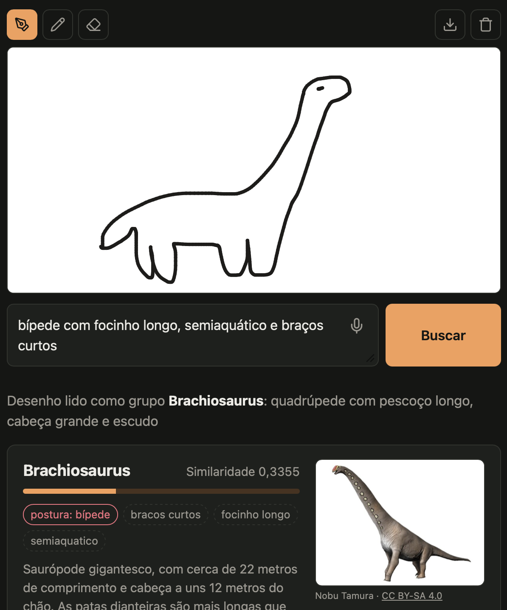
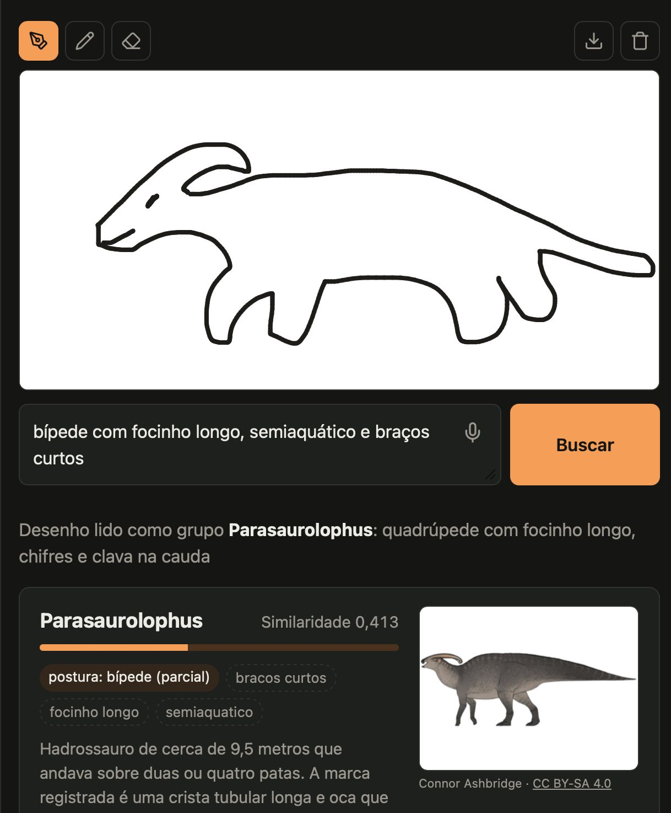
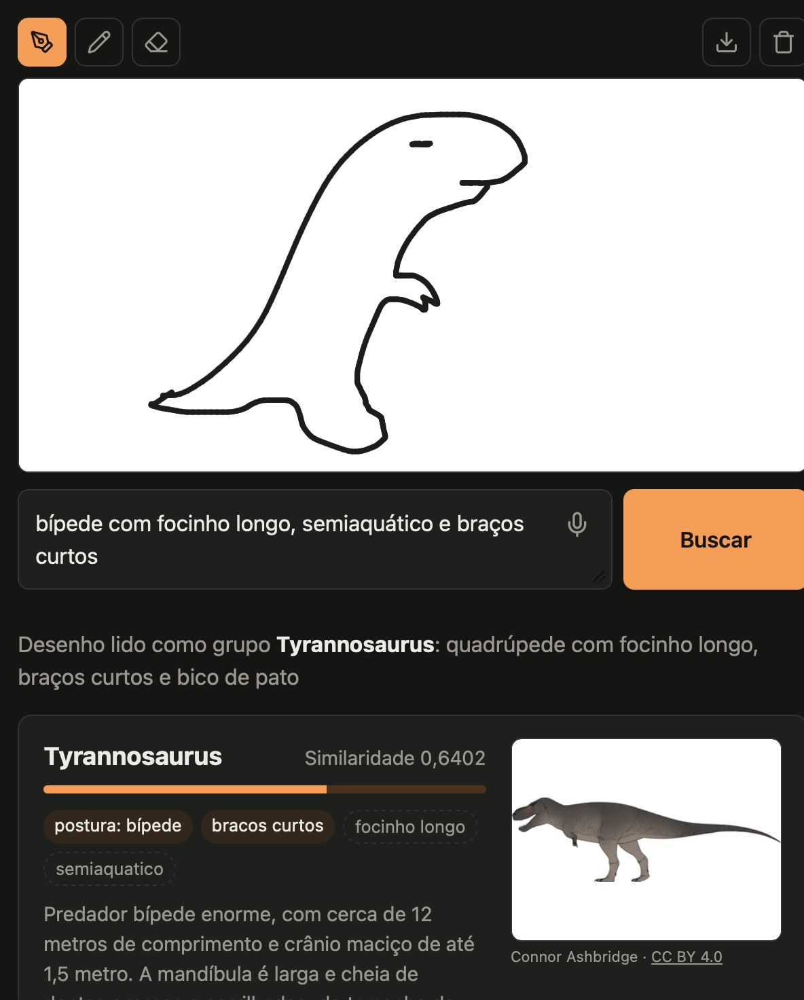

# Dino Search: multimodal search with RRF
> Multimodal dinosaur search: draw a sketch, type or speak a Portuguese description, and reciprocal rank fusion (RRF) merges zero-shot CLIP sketch reading with a hybrid E5 + rule-based text search.

Draw a dinosaur, describe it, or both. Type or say "quadrúpede enorme com placas nas costas e
espinhos na cauda" ("huge quadruped with plates on its back and spikes on its tail") and get the
most similar of 64 dinosaurs, each with a score and a per-trait explanation.

Embeddings alone get negations and sizes wrong: "sem penas" ("without feathers") lands
right next to the feathered dinosaurs. So the search fuses multilingual E5 retrieval with a
rule-based extractor that reads traits, negations, sizes, names and nicknames ("t rex"),
and the hybrid beats either half on its own (MRR 0.982 vs 0.825 and 0.792).

You can also draw the dinosaur on the board. Zero-shot CLIP reads the sketch, picks the closest
of 8 popular groups and writes a Portuguese description, which then joins the text search
through reciprocal rank fusion.







## Installation

```sh
python3 -m venv .venv && source .venv/bin/activate
pip install -r requirements.txt
uvicorn app.main:app            # http://localhost:8000
```

The first run downloads the models (~2.8 GB: E5 for text, CLIP ViT-L/14 for sketches) and caches the dataset embeddings in `.cache/`,
rebuilt only when `data/dinos.json` or the model changes.

## Usage example

The interface and queries are in Portuguese, the language the extractor and dataset
target. Besides the page at `/`, there's a JSON API:

```sh
curl -s localhost:8000/search -H 'Content-Type: application/json' \
  -d '{"query": "carnívoro grande sem penas e sem vela", "top_k": 1}'
```

```json
[{
  "nome": "Allosaurus",
  "score_final": 2.2557,
  "similaridade": 0.9411,
  "score_embedding": 0.8528,
  "score_atributos": 1.0,
  "penalidade": 0.0,
  "tracos_correspondentes": ["dieta: carnívoro", "tamanho: grande", "sem penas", "sem vela_dorsal"],
  "tracos_nao_correspondentes": [],
  "tracos_conflitantes": [],
  "descricao_fisica": "Grande predador bípede do Jurássico, com..."
}]
```

`GET /dinos` lists the dataset as JSON; `/all` shows it as an illustrated grid.

`similaridade` is a match score on a 0–1 scale. It combines raw cosine similarity,
positive attribute matches when present, and exclusion penalties. The sort order
uses `score_final`, which includes per-query normalization and the popularity bonus.

## How it works

```
score_final = α · dense + β · attributes − γ · negation_penalty + popularity_bonus
```

- **dense**: `intfloat/multilingual-e5-base` cosine over each dinosaur's description and
  paraphrases (mean of its 2 best vectors), min-max normalized per query.
- **attributes**: regex lexicon (`app/search/extractor.py`) maps the query to posture, diet,
  size and a closed vocabulary of traits and group labels. Debated traits (feathers on Utahraptor, the
  Spinosaurus sail...) count 0.75. Dinosaur names and nicknames (`ALIASES` in
  `ranker.py`: "t rex", "rex", "tiranossauro", "argentina") count as one more attribute.
- **negation_penalty**: an excluded trait such as "sem penas" costs 1 when present
  (0.5 if debated). An exact match to an excluded diet, posture, or size such as
  "não é carnívoro" also costs 1.
- **popularity_bonus**: +0.1 for Tyrannosaurus, Spinosaurus aegyptiacus, Triceratops,
  Brachiosaurus, Stegosaurus, Ankylosaurus, Parasaurolophus and Velociraptor (`POPULAR` in
  `ranker.py`). A vague description most likely means one of them, so they win close calls.

Weights α = 1, β = 1.5, γ = 1 sit on the left edge of the plateau found by
`python -m eval.run_eval --grid`. Every result lists matched, missing and conflicting traits.

Results on the 74 queries in `eval/queries.json` (26 direct, 25 lay, 14 negation, 9
ambiguous):

| configuration | Top-1 | Top-3 | MRR |
|---|---|---|---|
| embeddings only | 0.770 | 0.892 | 0.844 |
| attributes only | 0.703 | 0.797 | 0.770 |
| **hybrid** | **0.986** | **1.000** | **0.993** |

Caveat: the dataset, lexicon and test queries share an author, and the weights were tuned
on the same set, so the attribute and hybrid numbers are optimistic.

### Sketch search (`POST /search/multimodal`)

A drawing adds rankings over the same 64 dinosaurs, all zero-shot (`app/search/sketch.py`):

- **nome**: CLIP compares the sketch with "a drawing of a ⟨popular⟩, a dinosaur" for the 8
  popular dinosaurs, and every dinosaur takes the rank of its group in `data/map.json`.
- **descrição**: CLIP picks posture and the 3 strongest traits, which become a Portuguese
  query ("quadrúpede com espinhos na cauda...") ranked by the hybrid search above.
- **busca**: the typed text, if any, ranked by the hybrid search.
- **popularidade**: the 8 popular dinosaurs share first place, since a drawn sauropod most
  likely means Brachiosaurus rather than Camarasaurus.

Weighted reciprocal rank fusion merges them, where rᵢ(d) is the 1-based rank of dinosaur d
in ranking i (a dinosaur missing from a ranking gets nothing from it):

```
RRF(d) = Σᵢ wᵢ / (k + rᵢ(d)),   k = 60
w = nome 200, descrição 1, busca 1, popularidade 0.5
```

The name weight is high on purpose: one rank down in nome costs more than all the other
rankings can add (200 · (1/67 − 1/68) > 2 · (1/61 − 1/124) + 0.5/61), so the group CLIP picks
always comes first and the rest only order the dinosaurs inside it. On the 25 sketches in
`eval/gt/`, CLIP picks the right group for 72% of them (`python -m eval.run_sketch_eval eval/gt/*.json`).

## Development setup

```sh
pip install -r requirements-dev.txt
pytest                          # the API test loads the model
python -m app.search.dinos      # validate data/dinos.json
python -m eval.run_eval         # Top-1 / Top-3 / MRR table (--grid, --failures, --model)
```

Illustrations come from Wikimedia Commons under CC BY / CC BY-SA. Author, license and
source for each are shown on its card and listed in `static/img/credits.json`.
